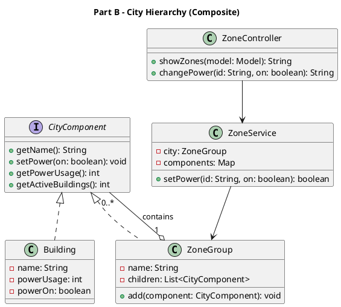
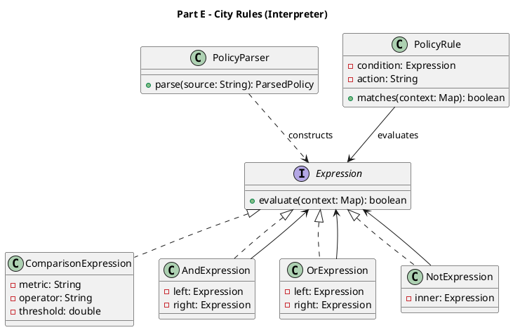

# SmartCity360 – UML Class Diagrams

Render these PlantUML diagrams at https://www.plantuml.com/plantuml/uml/ and export PNG images into the final PDF report. The assessment explicitly requests a class diagram for Parts B and E.

## Part B: Composite Pattern



## Part E: Interpreter Pattern



## Architecture Overview

```plantuml
@startuml
title SmartCity360 - Application Modules
rectangle "Thymeleaf / Web Browser" as web
class "HomeController" as home
class "EnergyController" as energy
class "ZoneController" as zone
class "ComplaintController" as complaint
class "LightController" as light
class "PolicyController" as policy
web --> home
web --> energy
web --> zone
web --> complaint
web --> light
web --> policy
@enduml
```
